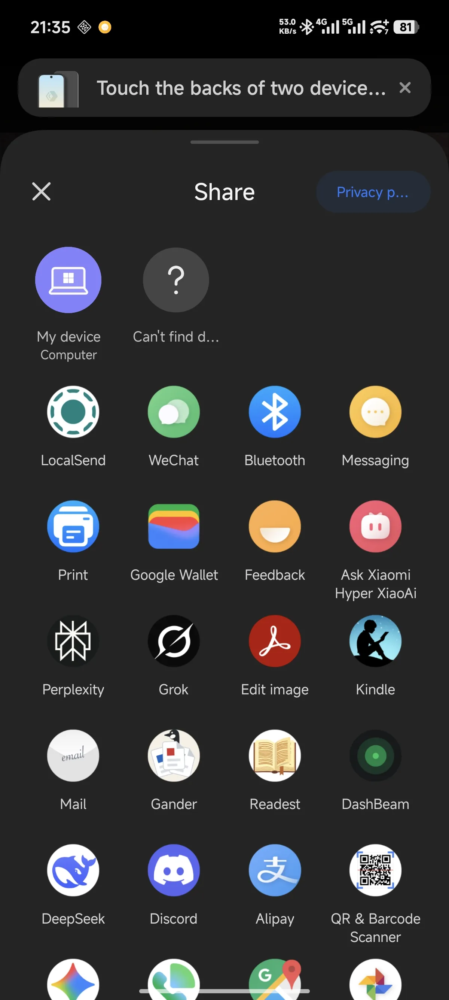
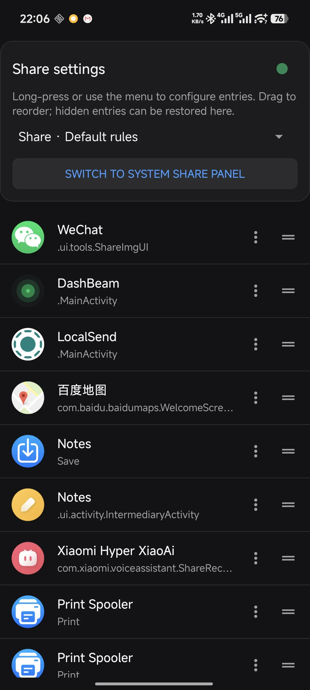

# Share Panel

支持分享列表的自定义排序。

Android 的分享和“打开方式”列表里常有大量应用入口，找到常用目标要翻找一阵。Share Panel 提供可配置的选择面板，可以隐藏多余入口，把常用入口排到前面。

目前已在 **小米 14、澎湃 OS 3** 上测试。其他 Android 系统的适配情况有待验证；系统分享组件、Root 管理方式和厂商限制可能有所差异。

## 功能

- **整理入口**：隐藏或恢复入口，拖动排序，也可以通过菜单将入口移到最前或最后。
- **按场景配置**：分享与打开方式、不同内容类型分别保存规则。预设包括图片、视频、文字、PDF 和 Word 文档等。
- **直接配置**：在应用首页选择场景，查看对应入口并调整规则。列表根据模拟请求生成；实际入口可能因来源应用及其请求内容而不同。
- **切换面板**：在首页切换系统原生与自定义 chooser。
- **文件授权转发**：对需要保留原始调用方身份的请求，可通过 Root 桥接服务转发。例如，已在测试设备上验证 Google Photos 分享图片到 LocalSend。

 

## 使用前须知

- 应用可安装在 Android 10（API 29）及以上设备。面板接管和文件转发的兼容性取决于系统实现；Root 桥接使用 Android 16 的特权接口，目前在上述设备上验证过。
- 切换系统面板和启动特权转发服务需要 Root，须在 Root 管理器中允许本应用使用 `su`。普通请求可以直接转发；部分文件分享需要桥接服务。
- Share Panel 接管系统的 `ACTION_CHOOSER` 入口。应用自带的分享界面、直接指定目标的跳转，以及通过其他方式调用的“打开方式”，可能继续使用原有界面。
- 切换按钮针对 `com.android.intentresolver/.ChooserActivity`。其他系统的组件名称可能不同，使用前请确认。
- 应用声明 `QUERY_ALL_PACKAGES`，用于发现可处理请求的应用入口。
- 桥接以 Root 进程运行，重启后需要重新激活。若使用临时 Root，须先恢复 Root。首页右上角状态点可查看并激活服务。

## 开始使用

1. 安装 APK，打开**分享面板**，在 Root 管理器中授予它 Root 权限。
2. 在首页点击**切换为自定义分享面板**。该操作会停用目标系统 chooser 组件，并检查实际解析结果。
3. 在首页的场景选择器中选择分享或打开方式，使用入口右侧菜单隐藏、恢复或移动入口；也可以拖动排序。
4. 点击右上角状态点；如显示服务未运行，可在弹窗中激活特权转发服务。
5. 从来源应用发起一次实际分享或打开请求，确认目标列表与文件访问正常。

系统原生面板可在首页通过**切换为系统原生分享面板**恢复。切换时只更改系统 chooser 组件的启用状态，系统 APK 保持原样。

> **卸载前先切回系统原生面板，并确认分享功能正常。**直接卸载自定义面板时，系统 chooser 组件可能仍处于停用状态。

如果已经卸载、系统分享入口不可用，并且设备仍能通过 ADB 获得 Root，可恢复该组件的默认状态（示例为用户 0）：

```sh
adb shell su -c 'cmd package default-state --user 0 com.android.intentresolver/com.android.intentresolver.ChooserActivity'
```

此命令针对上面列出的系统组件；其他系统可能使用不同组件。恢复后请实际发起一次分享，确认系统面板可用。

## 从源码构建

项目使用 Gradle Wrapper、Android Gradle Plugin 9.4.1 和 Android SDK API 37 编译；已使用 JDK 21 构建。请先安装对应 JDK 和 Android SDK，并让 Gradle 能找到 SDK。

构建脚本在配置阶段读取项目根目录的 `signing.properties`，debug 和 release 构建都需要该文件。发布版本还需要自己的签名密钥；请使用自己的密钥，并妥善保管。

1. 在项目根目录创建 `signing/`，用 `keytool` 生成自己的密钥库，例如：

   ```sh
   keytool -genkeypair -v -keystore signing/local.jks -alias share-panel -keyalg RSA -keysize 2048 -validity 10000
   ```

2. 在项目根目录创建 `signing.properties`，将下面的值替换为自己的配置：

   ```properties
   storeFile=signing/local.jks
   storePassword=YOUR_KEYSTORE_PASSWORD
   keyAlias=share-panel
   keyPassword=YOUR_KEY_PASSWORD
   ```

3. 构建：

   ```sh
   ./gradlew :app:assembleDebug
   ./gradlew :app:assembleRelease
   ```

   Windows 可使用 `gradlew.bat`。APK 分别位于 `app/build/outputs/apk/debug/` 和 `app/build/outputs/apk/release/`。

`signing.properties` 和 `signing/` 已列入 `.gitignore`。发布前仍应确认它们未被 Git 跟踪或包含在既有提交中；已跟踪的文件需要另外处理。

## 工作方式与限制

Share Panel 是普通 APK。使用自定义面板时，应用以 Root 修改系统 chooser 组件的启用状态；对需要特殊文件授权的请求，另行启动 Root 桥接进程，以原始调用方身份启动目标应用。系统分区和系统 APK 保持原样。

不同厂商的系统实现和 Android 版本可能影响 chooser 解析、Root 授权及文件访问。切换按钮先修改组件状态，再检查系统解析结果；即使检查报错，组件状态也可能已经改变。如果切换失败或分享后目标应用无法读取文件，请先切回系统原生面板并确认可用，再检查 Root 授权和右上角的服务状态。
